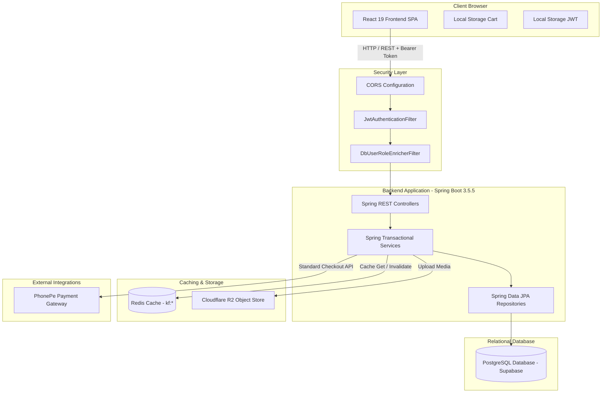
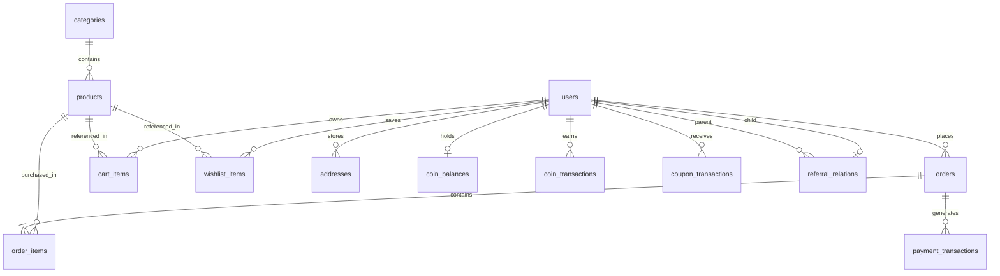
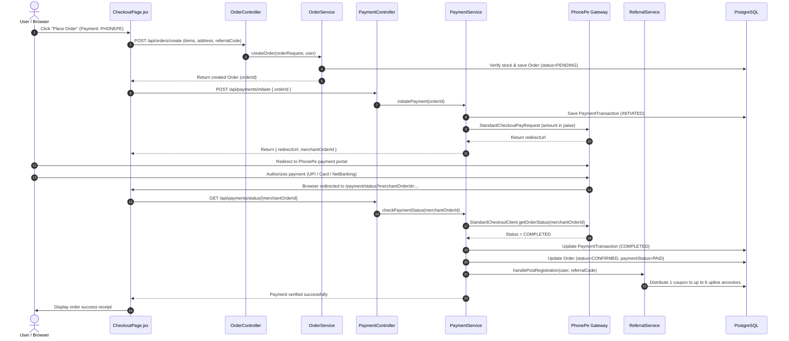
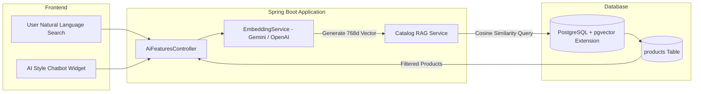

# KuberFashion — Complete Technical Architecture & Codebase Inventory

> **Document Type:** Production Codebase Audit & Architectural Inventory  
> **Repository Target:** `KuberFashion` Full-Stack Monorepo / Services  
> **Backend Base:** `com.kuberfashion.backend` (Spring Boot 3.5.5 / Java 21)  
> **Frontend Base:** `kuberfashion-frontend` (React 19.1.1 / Vite 7.1.2 / Tailwind CSS 4.1.13)  
> **Audit Status:** Verified against source code and active configuration  

---

## 1. Project Overview

**KuberFashion** is an enterprise e-commerce platform combining traditional retail apparel shopping with a multi-tier referral and coupon rewards engine (**KVision Network**). The platform supports retail fashion discovery, size/color variant selection, synchronized cart management, multi-address shipping, PhonePe payment processing, and administrative inventory and member hierarchy tracking.

### Core Architecture & Operating Model
- **Architectural Style:** Decoupled Single Page Application (SPA) communicating via RESTful JSON APIs with a stateless Spring Boot microservice backend.
- **Frontend Responsibilities:** Single Page Application rendering (React 19, React Router 7), authentication lifecycle handling, local-to-remote cart reconciliation, checkout state collection, PhonePe redirect handling, and role-based administrative dashboards.
- **Backend Responsibilities:** REST API routing, JWT token generation & verification, role-based security filters, multi-tier referral tree traversal, PhonePe SDK orchestration, AWS S3/Cloudflare R2 media upload management, Redis cache invalidation, and transactional database persistence via PostgreSQL / Hibernate.
- **Data Flow:** Clients initiate HTTP requests over HTTPS/REST with Bearer JWT tokens. Requests pass through Spring Security filters (`JwtAuthenticationFilter`, `DbUserRoleEnricherFilter`) to Spring RestControllers, invoking `@Transactional` Service layer beans interacting with Spring Data JPA Repositories and PostgreSQL.

### Verified User Personas
1. **Anonymous Guests:** Can browse public product catalogs, filter by categories and prices, search by keywords, view product details, and maintain temporary cart items in browser `localStorage`.
2. **Registered Customers (`ROLE_USER`):** Can manage authenticated carts (synced to database), maintain wishlists, store multiple shipping addresses, initiate orders, pay via PhonePe or Cash on Delivery, view personal referral trees, and track accumulated Kuber coupons.
3. **Administrators (`ROLE_ADMIN`):** Can access `/admin/*` dashboards, manage products (create, update stock, toggle active/featured/offer flags), view and update customer orders, inspect and adjust user balances/coupons, upload media assets to Cloudflare R2, and inspect the company-wide multi-level referral graph.

---

## 2. Current Application Capabilities

### Customer Capabilities
- **Product Catalog & Filtering:** Browse categorized apparel (Men, Women, Kids, Accessories, KVision), apply price range filters, fetch trending items, featured products, and seasonal offers.
- **Variant Selection:** Interactive selection of apparel sizes (`S`, `M`, `L`, `XL`, `XXL`) and color variants stored as element collections.
- **Persistent Multi-State Cart:** Automatic reconciliation: guest items added to `localStorage` sync to PostgreSQL `cart_items` upon login.
- **Address Book:** CRUD operations for multiple delivery addresses with default selection flags (`addresses` table).
- **Checkout & Multi-Mode Ordering:** Checkout supporting standard delivery, PhonePe PG integration, Cash on Delivery, and KVision referral validation.
- **Wishlist Management:** Add, remove, and toggle items to a personal wishlist linked to the user entity.
- **KVision Member Network:** Tree visualization of downline referrals up to 6 levels deep, displaying earned Kuber coupons and referral codes (mobile number based).

### Administrative Capabilities
- **Executive Dashboard:** Real-time statistics aggregation for total revenue, active orders, customer counts, and product quantities.
- **Catalog Management:** Create products with multiple image URLs, configure discounts, stock quantities, and categorization; toggle offer/featured statuses.
- **Order Lifecycle Management:** View sitewide customer orders, update workflow states (`PENDING` -> `CONFIRMED` -> `PROCESSING` -> `SHIPPED` -> `DELIVERED` -> `CANCELLED`), and update payment statuses.
- **User & Coupon Governance:** View customer lists, deactivate/activate user accounts, promote users to `ADMIN`, and manually credit or debit Kuber coupons with audit notes.
- **Direct S3/R2 Asset Ingestion:** Multipart file uploads directly processed to Cloudflare R2 bucket with automated timestamp and UUID naming.
- **Global Referral Visualization:** Full tree generation for visualizing company-wide network genealogy down from the genesis root.

---

## 3. Feature Implementation Matrix

| Feature | Status | What Is Implemented | Evidence / Code Paths | Missing Pieces or Limitations |
|---|---|---|---|---|
| **User Registration & Login** | **Implemented** | Phone + Password login, Email/Password registration, duplicate checks, BCrypt hashing. | [AuthController.java](file:///Users/saimandsroy/Coding/KF/kuberFashion_backend_2025-main/src/main/java/com/kuberfashion/backend/controller/AuthController.java), [UserService.java](file:///Users/saimandsroy/Coding/KF/kuberFashion_backend_2025-main/src/main/java/com/kuberfashion/backend/service/UserService.java), [LoginPage.jsx](file:///Users/saimandsroy/Coding/KF/kuberFashion_frontend_2025-main/src/pages/LoginPage.jsx) | Password reset requires admin intervention; self-service forgot password email/SMS flow is not implemented. |
| **JWT Authentication & Roles** | **Implemented** | Stateless HMAC-SHA256 tokens (`jwt.secret`), role assignment (`ROLE_USER`, `ROLE_ADMIN`), role verification filters. | [JwtAuthenticationFilter.java](file:///Users/saimandsroy/Coding/KF/kuberFashion_backend_2025-main/src/main/java/com/kuberfashion/backend/security/JwtAuthenticationFilter.java), [SecurityConfig.java](file:///Users/saimandsroy/Coding/KF/kuberFashion_backend_2025-main/src/main/java/com/kuberfashion/backend/config/SecurityConfig.java) | Refresh tokens are absent; users are logged out when access token expires. Supabase JWKS decoder has fallback to Google OAuth certs. |
| **Product Browsing & Discovery** | **Implemented** | Paginated catalog, slug resolution, price filtering, category mapping, search queries. | [ProductController.java](file:///Users/saimandsroy/Coding/KF/kuberFashion_backend_2025-main/src/main/java/com/kuberfashion/backend/controller/ProductController.java), [ProductService.java](file:///Users/saimandsroy/Coding/KF/kuberFashion_backend_2025-main/src/main/java/com/kuberfashion/backend/service/ProductService.java) | Search uses standard SQL `LIKE %keyword%`; no fuzzy search, typo-tolerance, or Elasticsearch/Full-Text indexing. |
| **Product Variant Management** | **Implemented** | Size and color collections stored via `@ElementCollection` in `product_sizes` and `product_colors`. | [Product.java](file:///Users/saimandsroy/Coding/KF/kuberFashion_backend_2025-main/src/main/java/com/kuberfashion/backend/entity/Product.java#L53-L76) | Stock is tracked globally per product (`stockQuantity`), not granularly per size/color variant combination. |
| **Shopping Cart** | **Implemented** | Guest cart in `localStorage`, database-backed cart in `cart_items`, automatic guest-to-account merge logic. | [CartController.java](file:///Users/saimandsroy/Coding/KF/kuberFashion_backend_2025-main/src/main/java/com/kuberfashion/backend/controller/CartController.java), [CartService.java](file:///Users/saimandsroy/Coding/KF/kuberFashion_backend_2025-main/src/main/java/com/kuberfashion/backend/service/CartService.java), [CartContext.jsx](file:///Users/saimandsroy/Coding/KF/kuberFashion_frontend_2025-main/src/context/CartContext.jsx) | No reservation hold on stock while items are in cart; inventory check occurs only at order creation. |
| **Address Management** | **Implemented** | Multi-address storage per user, default address toggle, validation constraints. | [AddressController.java](file:///Users/saimandsroy/Coding/KF/kuberFashion_backend_2025-main/src/main/java/com/kuberfashion/backend/controller/AddressController.java), [AddressService.java](file:///Users/saimandsroy/Coding/KF/kuberFashion_backend_2025-main/src/main/java/com/kuberfashion/backend/service/AddressService.java) | Delivery zip code serviceability verification is not implemented. |
| **Order Placement & Tracking** | **Implemented** | Multi-item checkout, snapshot of pricing in `order_items`, order history tracking, order cancellation. | [OrderController.java](file:///Users/saimandsroy/Coding/KF/kuberFashion_backend_2025-main/src/main/java/com/kuberfashion/backend/controller/OrderController.java), [OrderService.java](file:///Users/saimandsroy/Coding/KF/kuberFashion_backend_2025-main/src/main/java/com/kuberfashion/backend/service/OrderService.java) | Automatic shipping courier API integration (e.g., Shiprocket, Delhivery) is not integrated. Tracking numbers are manual notes. |
| **PhonePe Payment Integration** | **Implemented** | Official PhonePe SDK v2.1.8 integration, `StandardCheckoutClient`, payment initiation, fallback simulation mode. | [PaymentController.java](file:///Users/saimandsroy/Coding/KF/kuberFashion_backend_2025-main/src/main/java/com/kuberfashion/backend/controller/PaymentController.java), [PaymentService.java](file:///Users/saimandsroy/Coding/KF/kuberFashion_backend_2025-main/src/main/java/com/kuberfashion/backend/service/PaymentService.java) | Webhook signature verification is stubbed out. `/api/payments/confirm` is unauthenticated and can be triggered externally. |
| **KVision Referral / MLM Tree** | **Implemented** | 6-level ancestor referral tree, phone number referral codes, genesis code `kuberfashion2025`, 5 direct referral limit. | [ReferralController.java](file:///Users/saimandsroy/Coding/KF/kuberFashion_backend_2025-main/src/main/java/com/kuberfashion/backend/controller/ReferralController.java), [ReferralService.java](file:///Users/saimandsroy/Coding/KF/kuberFashion_backend_2025-main/src/main/java/com/kuberfashion/backend/service/ReferralService.java) | Commission cash payouts are not automated; awards are recorded as Kuber Coupons. Coupon deduction at checkout is not automated. |
| **Cloudflare R2 Media Storage** | **Implemented** | AWS S3 SDK v2 integration writing to Cloudflare R2 endpoint with public CDN delivery. | [FileStorageService.java](file:///Users/saimandsroy/Coding/KF/kuberFashion_backend_2025-main/src/main/java/com/kuberfashion/backend/service/FileStorageService.java), [FileUploadController.java](file:///Users/saimandsroy/Coding/KF/kuberFashion_backend_2025-main/src/main/java/com/kuberfashion/backend/controller/FileUploadController.java) | Supabase storage service is marked `@Deprecated`. File deletion from bucket on product delete is manual. |
| **Redis Caching** | **Implemented** | Redis cache manager for product queries (`products_list`), 10-minute TTL, key invalidation on product mutates. | [RedisConfig.java](file:///Users/saimandsroy/Coding/KF/kuberFashion_backend_2025-main/src/main/java/com/kuberfashion/backend/config/RedisConfig.java), [ProductService.java](file:///Users/saimandsroy/Coding/KF/kuberFashion_backend_2025-main/src/main/java/com/kuberfashion/backend/service/ProductService.java) | Individual product caching by ID (`@Cacheable(value = "products", key = "#id")`) is disabled due to Jackson LinkedHashMap deserialization bugs. |
| **Reviews & Ratings** | **Partially implemented** | Rating and reviews counts exist as scalar columns on `Product`, displayed on frontend cards. | [Product.java](file:///Users/saimandsroy/Coding/KF/kuberFashion_backend_2025-main/src/main/java/com/kuberfashion/backend/entity/Product.java#L58-L62) | No `Review` entity exists. Users cannot submit reviews or star ratings; values are set administratively. |
| **Coupons & Discounts** | **Partially implemented** | `CouponTransaction` entity records awards/deductions; user balance has `kuberCoupons`. Admin can adjust. | [CouponTransaction.java](file:///Users/saimandsroy/Coding/KF/kuberFashion_backend_2025-main/src/main/java/com/kuberfashion/backend/entity/CouponTransaction.java), [AdminController.java](file:///Users/saimandsroy/Coding/KF/kuberFashion_backend_2025-main/src/main/java/com/kuberfashion/backend/controller/AdminController.java) | Checkout form does not have an active promo code validation or dynamic coupon redemption discount calculator. |
| **Notifications / SMS / Email** | **Not implemented** | `InMemoryOtpService` logs mock OTPs to application console. | [InMemoryOtpService.java](file:///Users/saimandsroy/Coding/KF/kuberFashion_backend_2025-main/src/main/java/com/kuberfashion/backend/service/InMemoryOtpService.java) | No Twilio, AWS SES, SendGrid, or SMS gateway integrated. OTPs and notifications cannot reach real devices. |
| **AI / Machine Learning** | **Not implemented** | None currently present in either frontend or backend codebases. | N/A | Extension points designed below for semantic search, recommendation engine, and catalog tagger. |

---

## 4. Actual Technology Stack

### Backend Stack

| Layer | Technology | Version | Actual Usage | Evidence / Code Paths | Status |
|---|---|---|---|---|---|
| **Language** | Java | 21 (Temurin / OpenJDK) | Primary programming language | [pom.xml](file:///Users/saimandsroy/Coding/KF/kuberFashion_backend_2025-main/pom.xml#L30) | Active |
| **Framework** | Spring Boot | 3.5.5 | Core web framework, IoC container, auto-configuration | [pom.xml](file:///Users/saimandsroy/Coding/KF/kuberFashion_backend_2025-main/pom.xml#L8) | Active |
| **Security** | Spring Security | 6.x | Security filter chain, RBAC, password encoding | [SecurityConfig.java](file:///Users/saimandsroy/Coding/KF/kuberFashion_backend_2025-main/src/main/java/com/kuberfashion/backend/config/SecurityConfig.java) | Active |
| **Tokens** | JJWT | 0.11.5 | JWT token builder, parser, and HMAC-SHA256 validation | [JwtTokenProvider.java](file:///Users/saimandsroy/Coding/KF/kuberFashion_backend_2025-main/src/main/java/com/kuberfashion/backend/security/JwtTokenProvider.java) | Active |
| **Persistence** | Spring Data JPA / Hibernate | 6.x | ORM mapping, repositories, transaction management | [ProductRepository.java](file:///Users/saimandsroy/Coding/KF/kuberFashion_backend_2025-main/src/main/java/com/kuberfashion/backend/repository/ProductRepository.java) | Active |
| **Database** | PostgreSQL | 15+ / Supabase | Relational data store | [V1__Create_users_table.sql](file:///Users/saimandsroy/Coding/KF/kuberFashion_backend_2025-main/src/main/resources/db/migration/V1__Create_users_table.sql) | Active |
| **Schema Migrations**| Flyway | Integrated | Versioned SQL database migrations (V1 to V8) | [db/migration/](file:///Users/saimandsroy/Coding/KF/kuberFashion_backend_2025-main/src/main/resources/db/migration) | Active |
| **Caching** | Redis (Spring Data Redis) | Lettuce driver | Key-value caching for product listings (`kf:*`) | [RedisConfig.java](file:///Users/saimandsroy/Coding/KF/kuberFashion_backend_2025-main/src/main/java/com/kuberfashion/backend/config/RedisConfig.java) | Active |
| **Payment Gateway** | PhonePe PG SDK | 2.1.8 | Standard Checkout Client payment initiation & status | [PaymentService.java](file:///Users/saimandsroy/Coding/KF/kuberFashion_backend_2025-main/src/main/java/com/kuberfashion/backend/service/PaymentService.java#L58-L64) | Active |
| **Object Storage** | AWS S3 Java SDK | 2.21.29 | Cloudflare R2 bucket connection for image assets | [FileStorageService.java](file:///Users/saimandsroy/Coding/KF/kuberFashion_backend_2025-main/src/main/java/com/kuberfashion/backend/service/FileStorageService.java#L11-L13) | Active |
| **API Docs** | SpringDoc OpenAPI | 2.6.0 | Swagger UI and OpenAPI 3 schema generation | [pom.xml](file:///Users/saimandsroy/Coding/KF/kuberFashion_backend_2025-main/pom.xml#L173-L176) | Active |
| **Containerization** | Docker / Compose | Multi-stage | Alpine Java runtime container + Postgres/Redis services | [Dockerfile](file:///Users/saimandsroy/Coding/KF/kuberFashion_backend_2025-main/Dockerfile), [docker-compose.yml](file:///Users/saimandsroy/Coding/KF/kuberFashion_backend_2025-main/docker-compose.yml) | Active |

### Frontend Stack

| Layer | Technology | Version | Actual Usage | Evidence / Code Paths | Status |
|---|---|---|---|---|---|
| **Core Library** | React | 19.1.1 | Reactive declarative UI component tree | [package.json](file:///Users/saimandsroy/Coding/KF/kuberFashion_frontend_2025-main/package.json#L20) | Active |
| **Build Tool** | Vite | 7.1.2 | Fast HMR dev server & production bundling | [package.json](file:///Users/saimandsroy/Coding/KF/kuberFashion_frontend_2025-main/package.json#L39) | Active |
| **Routing** | React Router DOM | 7.9.1 | Client-side routing, route guards (`RequireAuth`, `RequireRole`) | [App.jsx](file:///Users/saimandsroy/Coding/KF/kuberFashion_frontend_2025-main/src/App.jsx#L2) | Active |
| **Styling** | Tailwind CSS | 4.1.13 | Utility-first responsive CSS styling with PostCSS plugin | [package.json](file:///Users/saimandsroy/Coding/KF/kuberFashion_frontend_2025-main/package.json#L38) | Active |
| **HTTP Client** | Axios | 1.12.2 | API requests with interceptors for JWT injection | [api.js](file:///Users/saimandsroy/Coding/KF/kuberFashion_frontend_2025-main/src/services/api.js#L1-L37) | Active |
| **Animations** | Framer Motion | 12.23.13 | UI micro-interactions, modal transitions, fade-ins | [CheckoutPage.jsx](file:///Users/saimandsroy/Coding/KF/kuberFashion_frontend_2025-main/src/user/pages/CheckoutPage.jsx#L3) | Active |
| **Icons** | Lucide React | 0.544.0 | SVG iconography throughout store and admin interfaces | [package.json](file:///Users/saimandsroy/Coding/KF/kuberFashion_frontend_2025-main/package.json#L18) | Active |
| **Notifications** | React Toastify | 10.0.6 | User notification popups for cart/auth events | [package.json](file:///Users/saimandsroy/Coding/KF/kuberFashion_frontend_2025-main/package.json#L23) | Active |

---

## 5. Architecture



---

## 6. Repository Structure

```
KF/
├── kuberFashion_backend_2025-main/          # Spring Boot 3.5.5 Backend API
│   ├── src/main/java/com/kuberfashion/backend/
│   │   ├── config/                          # Security, Redis, PhonePe, S3/R2 configurations
│   │   ├── controller/                      # 19 REST Controllers exposing 50+ endpoints
│   │   ├── dto/                             # Data Transfer Objects & API response wrappers
│   │   ├── entity/                          # 13 JPA Entities mapping relational tables
│   │   ├── exception/                       # Custom exceptions & GlobalExceptionHandler
│   │   ├── repository/                      # 12 Spring Data JPA Repositories
│   │   ├── security/                        # JWT authentication filters & providers
│   │   └── service/                         # 14 Business logic service implementations
│   ├── src/main/resources/
│   │   ├── db/migration/                    # Flyway SQL migrations (V1 to V8)
│   │   ├── application.properties           # Base application configuration
│   │   └── application-prod.properties      # Production override profiles
│   ├── Dockerfile                           # Multi-stage production container build
│   ├── docker-compose.yml                   # Local Docker stack (App + Postgres + Redis)
│   └── pom.xml                              # Maven build specifications and dependencies
│
└── kuberFashion_frontend_2025-main/         # React 19 + Vite 7 Frontend Application
    ├── src/
    │   ├── admin/                           # Administrative subsystem
    │   │   ├── components/                  # Admin layout, sidebar, stat cards
    │   │   └── pages/                       # Dashboard, Products, Orders, Users, Referrals
    │   ├── user/pages/                      # Customer authenticated pages (Checkout, Orders, etc.)
    │   ├── pages/                           # Public pages (Home, Catalog, Product Details, Auth)
    │   ├── components/                      # Shared reusable UI elements (Header, Footer, Buttons)
    │   ├── context/                         # CartContext, WishlistContext providers
    │   ├── hooks/                           # useAuth custom hook for session lifecycle
    │   ├── services/                        # Axios api.js configuring endpoints & interceptors
    │   └── utils/                           # Route guards (RequireAuth, RequireRole)
    ├── package.json                         # Node dependencies & Vite build scripts
    └── vite.config.js                       # Vite bundling configuration
```

---

## 7. Frontend Implementation

### Route Organization & Protection

| Route | Component | Access Level | Description |
|---|---|---|---|
| `/` | `HomePage.jsx` | Public | Hero banners, category highlights, trending product previews |
| `/login` | `LoginPage.jsx` | Public | Phone/email authentication form |
| `/signup` | `SignupPage.jsx` | Public | Account registration form with referral code input |
| `/admin/login` | `LoginPage.jsx` | Public | Administrative login entry |
| `/categories/:category` | `CategoryPage.jsx` | Public | Category-filtered product grid with sorting and pricing filters |
| `/products/:productId` | `ProductDetailPage.jsx` | Public | Image gallery, variant selection (size/color), and add-to-cart |
| `/search` | `SearchResults.jsx` | Public | Keyword search results |
| `/cart` | `CartPage.jsx` | Authenticated | View cart items, adjust quantity, price breakdown, proceed to checkout |
| `/checkout` | `CheckoutPage.jsx` | Authenticated | Select/create delivery address, choose PhonePe/COD, apply referral |
| `/payment/status` | `PaymentStatusPage.jsx`| Authenticated | Polls payment status from backend or confirms simulated sandbox checkout |
| `/orders` | `OrdersPage.jsx` | Authenticated | Customer order history list with status badges |
| `/orders/:orderId` | `OrderDetailsPage.jsx` | Authenticated | Line item receipt, delivery address, and cancellation action |
| `/wishlist` | `WishlistPage.jsx` | Authenticated | Saved items with one-click transfer to cart |
| `/referral` | `Referral.jsx` | Authenticated | KVision network visualizer, referral link generator, coupon tally |
| `/profile` | `UserProfilePage.jsx` | Authenticated | Account info update, password change form |
| `/admin/dashboard` | `AdminDashboard.jsx` | Admin Only | Sitewide financial metrics, counts, and recent activity |
| `/admin/products` | `AdminProducts.jsx` | Admin Only | Product list, create modal, stock updater, status toggles |
| `/admin/orders` | `AdminOrders.jsx` | Admin Only | Full customer orders table with status mutation dropdowns |
| `/admin/users` | `AdminUsers.jsx` | Admin Only | Customer directory, role switcher, manual coupon balance adjustment |
| `/admin/referrals` | `AdminReferrals.jsx` | Admin Only | Interactive multi-level company referral hierarchy inspector |
| `/admin/uploads` | `AdminUploads.jsx` | Admin Only | Direct Cloudflare R2 image upload interface |

---

## 8. Backend Implementation

### Service Architecture & Key Responsibilities

1. **`UserService.java`**: Implements Spring Security's `UserDetailsService`. Handles user creation, password encryption via `BCryptPasswordEncoder`, validation of duplicate phones and emails, and profile mutations.
2. **`ProductService.java`**: Manages the product catalog. Applies Spring `@Cacheable(value = "products_list")` on category queries, trending items, and featured items. Triggers `@CacheEvict(allEntries = true)` when products are modified or created.
3. **`CartService.java`**: Manages customer cart state in `cart_items`. Handles atomic quantity modifications, duplicate item detection for identical size/color variants, and cart resets.
4. **`OrderService.java`**: Coordinates multi-item transactional checkout. Validates stock availability, generates unique formatted order numbers (`KF{timestamp}{random}`), copies line prices into `order_items`, and calculates tax/shipping amounts.
5. **`PaymentService.java`**: Integrates with PhonePe Standard Checkout SDK v2.1.8. Instantiates `StandardCheckoutClient` based on environment (`SANDBOX` vs `PRODUCTION`), generates payment redirect URLs in paise, records `PaymentTransaction` states, and coordinates with `ReferralService` upon successful payment.
6. **`ReferralService.java`**: Manages the 6-level KVision referral matrix. Validates member phone numbers, enforces the 5 direct referral limit per user, prevents self-referrals and circular parent chains, handles the single-use genesis code (`kuberfashion2025`), and distributes Kuber coupons to up to 6 upline ancestors.
7. **`FileStorageService.java`**: Connects to Cloudflare R2 using AWS S3 SDK v2 (`S3Client`). Uploads multipart image files, sets MIME content types, and returns publicly accessible CDN URLs.

---

## 9. Database and Data Model

### Entity-Relationship Architecture



### Relational Schema Inventory

1. **`users`** (`id` BIGSERIAL PK):
   - `first_name`, `last_name`, `email` (nullable, unique), `phone` (VARCHAR(15), unique, NOT NULL), `password` (BCrypt hash), `role` (`USER`, `ADMIN`), `is_enabled` (BOOLEAN), `kuber_coupons` (INT default 0), `supabase_id`, `created_at`, `updated_at`.
2. **`categories`** (`id` BIGSERIAL PK):
   - `name`, `slug` (unique), `image`, `description`, `created_at`, `updated_at`.
3. **`products`** (`id` BIGSERIAL PK):
   - `name`, `slug` (unique), `price` (DECIMAL(10,2)), `original_price`, `discount`, `category_id` (FK -> categories.id), `image`, `rating` (DECIMAL(2,1)), `reviews` (INT), `description`, `in_stock` (BOOLEAN), `featured` (BOOLEAN), `stock_quantity` (INT), `is_active` (BOOLEAN), `is_offer` (BOOLEAN).
   - *Child Collections:* `product_images` (product_id, image_url), `product_sizes` (product_id, size), `product_colors` (product_id, color_name).
4. **`cart_items`** (`id` BIGSERIAL PK):
   - `user_id` (FK -> users.id), `product_id` (FK -> products.id), `quantity`, `selected_size`, `selected_color`, `created_at`, `updated_at`.
5. **`addresses`** (`id` BIGSERIAL PK):
   - `user_id` (FK -> users.id), `label`, `first_name`, `last_name`, `phone`, `address_line1`, `address_line2`, `city`, `state`, `postal_code`, `country`, `is_default` (BOOLEAN).
6. **`orders`** (`id` BIGSERIAL PK):
   - `order_number` (VARCHAR(50), unique), `user_id` (FK -> users.id), `status` (`PENDING`, `CONFIRMED`, `PROCESSING`, `SHIPPED`, `DELIVERED`, `CANCELLED`, `RETURNED`), `total_amount`, `subtotal`, `tax_amount`, `shipping_amount`, `total_items`, `shipping_first_name`, `shipping_last_name`, `shipping_address_line1`, `shipping_address_line2`, `shipping_city`, `shipping_state`, `shipping_postal_code`, `shipping_country`, `shipping_phone`, `payment_method` (`PHONEPE`, `CASH_ON_DELIVERY`), `payment_status` (`PENDING`, `PAID`, `FAILED`, `REFUNDED`), `payment_transaction_id`, `referral_code`, `purchase_mode` (`ONLINE`, `OFFLINE`), `created_at`, `paid_at`.
7. **`order_items`** (`id` BIGSERIAL PK):
   - `order_id` (FK -> orders.id), `product_id` (FK -> products.id), `quantity`, `unit_price`, `total_price`, `selected_size`, `selected_color`.
8. **`payment_transactions`** (`id` BIGSERIAL PK):
   - `order_id` (FK -> orders.id), `merchant_order_id` (VARCHAR(100), unique), `phonepe_transaction_id`, `amount`, `status` (`INITIATED`, `PENDING`, `COMPLETED`, `FAILED`), `payment_method`, `error_code`, `error_message`, `redirect_url`, `created_at`.
9. **`referral_relations`** (`id` BIGSERIAL PK):
   - `user_id` (FK -> users.id, unique), `parent_id` (FK -> users.id), `created_at`.
10. **`coupon_transactions`** (`id` BIGSERIAL PK):
    - `user_id` (FK -> users.id), `source_user_id` (FK -> users.id), `level` (INT 1-6), `amount` (INT), `action` (VARCHAR), `reason` (VARCHAR), `created_at`.
11. **`wishlist_items`** (`id` BIGSERIAL PK):
    - `user_id` (FK -> users.id), `product_id` (FK -> products.id), `created_at`.
12. **`coin_balances`** & **`coin_transactions`**:
    - Relational tables initialized for loyalty coin tracking.

---

## 10. Existing End-to-End Workflows

### Checkout and PhonePe Payment Execution Flow



---

## 11. Complete API Reference

### Public Authentication & Products (`/api/*`)

| Method | Endpoint | Purpose | Authentication | Request / Parameters | Response | Implementation |
|---|---|---|---|---|---|---|
| `POST` | `/api/auth/register` | Register customer account | Public | `{ firstName, lastName, phone, password, email? }` | `ApiResponse<AuthResponse>` | [AuthController.java](file:///Users/saimandsroy/Coding/KF/kuberFashion_backend_2025-main/src/main/java/com/kuberfashion/backend/controller/AuthController.java#L87) |
| `POST` | `/api/auth/login` | Email/Phone login | Public | `{ email, password }` or `{ phone, password }` | `ApiResponse<AuthResponse>` | [AuthController.java](file:///Users/saimandsroy/Coding/KF/kuberFashion_backend_2025-main/src/main/java/com/kuberfashion/backend/controller/AuthController.java#L47) |
| `POST` | `/api/auth/phone/login` | Dedicated phone login | Public | `{ phone, password }` | `ApiResponse<AuthResponse>` | [AuthController.java](file:///Users/saimandsroy/Coding/KF/kuberFashion_backend_2025-main/src/main/java/com/kuberfashion/backend/controller/AuthController.java#L69) |
| `POST` | `/api/admin/auth/login` | Admin portal login | Public | `{ email, password }` | `ApiResponse<AuthResponse>` | [AdminAuthController.java](file:///Users/saimandsroy/Coding/KF/kuberFashion_backend_2025-main/src/main/java/com/kuberfashion/backend/controller/AdminAuthController.java#L28) |
| `GET` | `/api/auth/me` | Fetch active user profile | `Bearer JWT` | None | `ApiResponse<UserDTO>` | [AuthController.java](file:///Users/saimandsroy/Coding/KF/kuberFashion_backend_2025-main/src/main/java/com/kuberfashion/backend/controller/AuthController.java#L125) |
| `GET` | `/api/products` | Paginated product list | Public | Query: `page`, `size`, `sortBy`, `sortDir` | `ApiResponse<Page<ProductDTO>>` | [ProductController.java](file:///Users/saimandsroy/Coding/KF/kuberFashion_backend_2025-main/src/main/java/com/kuberfashion/backend/controller/ProductController.java#L39) |
| `GET` | `/api/products/{id}` | Get product by numeric ID | Public | Path: `id` | `ApiResponse<ProductDTO>` | [ProductController.java](file:///Users/saimandsroy/Coding/KF/kuberFashion_backend_2025-main/src/main/java/com/kuberfashion/backend/controller/ProductController.java#L52) |
| `GET` | `/api/products/slug/{slug}`| Get product by URL slug | Public | Path: `slug` | `ApiResponse<ProductDTO>` | [ProductController.java](file:///Users/saimandsroy/Coding/KF/kuberFashion_backend_2025-main/src/main/java/com/kuberfashion/backend/controller/ProductController.java#L65) |
| `GET` | `/api/products/category/{categorySlug}` | Get products by category | Public | Path: `categorySlug` | `ApiResponse<List<ProductDTO>>` | [ProductController.java](file:///Users/saimandsroy/Coding/KF/kuberFashion_backend_2025-main/src/main/java/com/kuberfashion/backend/controller/ProductController.java#L107) |
| `GET` | `/api/products/featured` | Get featured apparel | Public | None | `ApiResponse<List<ProductDTO>>` | [ProductController.java](file:///Users/saimandsroy/Coding/KF/kuberFashion_backend_2025-main/src/main/java/com/kuberfashion/backend/controller/ProductController.java#L78) |
| `GET` | `/api/products/trending` | Get trending apparel | Public | None | `ApiResponse<List<ProductDTO>>` | [ProductController.java](file:///Users/saimandsroy/Coding/KF/kuberFashion_backend_2025-main/src/main/java/com/kuberfashion/backend/controller/ProductController.java#L87) |
| `GET` | `/api/products/offers` | Get special offers | Public | None | `ApiResponse<List<ProductDTO>>` | [ProductController.java](file:///Users/saimandsroy/Coding/KF/kuberFashion_backend_2025-main/src/main/java/com/kuberfashion/backend/controller/ProductController.java#L96) |
| `GET` | `/api/products/search` | Search by name/description | Public | Query: `keyword` or `q` | `ApiResponse<Page<ProductDTO>>` | [ProductController.java](file:///Users/saimandsroy/Coding/KF/kuberFashion_backend_2025-main/src/main/java/com/kuberfashion/backend/controller/ProductController.java#L136) |
| `GET` | `/api/categories` | List active categories | Public | None | `ApiResponse<List<CategoryDTO>>`| [CategoryController.java](file:///Users/saimandsroy/Coding/KF/kuberFashion_backend_2025-main/src/main/java/com/kuberfashion/backend/controller/CategoryController.java#L27) |

### Customer Protected APIs (`/api/*` with `ROLE_USER`)

| Method | Endpoint | Purpose | Authentication | Request / Parameters | Response | Implementation |
|---|---|---|---|---|---|---|
| `GET` | `/api/cart` | Retrieve user cart | `Bearer JWT` | None | `ApiResponse<List<CartItemDTO>>`| [CartController.java](file:///Users/saimandsroy/Coding/KF/kuberFashion_backend_2025-main/src/main/java/com/kuberfashion/backend/controller/CartController.java#L28) |
| `POST` | `/api/cart/add` | Add product to cart | `Bearer JWT` | `{ productId, quantity, size?, color? }`| `ApiResponse<CartItemDTO>` | [CartController.java](file:///Users/saimandsroy/Coding/KF/kuberFashion_backend_2025-main/src/main/java/com/kuberfashion/backend/controller/CartController.java#L39) |
| `PUT` | `/api/cart/items/{itemId}`| Update cart quantity | `Bearer JWT` | `{ quantity }` | `ApiResponse<CartItemDTO>` | [CartController.java](file:///Users/saimandsroy/Coding/KF/kuberFashion_backend_2025-main/src/main/java/com/kuberfashion/backend/controller/CartController.java#L52) |
| `DELETE` | `/api/cart/items/{itemId}`| Remove item from cart | `Bearer JWT` | Path: `itemId` | `ApiResponse<Void>` | [CartController.java](file:///Users/saimandsroy/Coding/KF/kuberFashion_backend_2025-main/src/main/java/com/kuberfashion/backend/controller/CartController.java#L64) |
| `DELETE` | `/api/cart` | Clear entire cart | `Bearer JWT` | None | `ApiResponse<Void>` | [CartController.java](file:///Users/saimandsroy/Coding/KF/kuberFashion_backend_2025-main/src/main/java/com/kuberfashion/backend/controller/CartController.java#L76) |
| `GET` | `/api/addresses` | List saved addresses | `Bearer JWT` | None | `ApiResponse<List<AddressDTO>>` | [AddressController.java](file:///Users/saimandsroy/Coding/KF/kuberFashion_backend_2025-main/src/main/java/com/kuberfashion/backend/controller/AddressController.java#L32) |
| `POST` | `/api/addresses` | Create new address | `Bearer JWT` | `AddressDTO` JSON | `ApiResponse<AddressDTO>` | [AddressController.java](file:///Users/saimandsroy/Coding/KF/kuberFashion_backend_2025-main/src/main/java/com/kuberfashion/backend/controller/AddressController.java#L51) |
| `PUT` | `/api/addresses/{id}/default`| Set default address | `Bearer JWT` | Path: `id` | `ApiResponse<AddressDTO>` | [AddressController.java](file:///Users/saimandsroy/Coding/KF/kuberFashion_backend_2025-main/src/main/java/com/kuberfashion/backend/controller/AddressController.java#L77) |
| `POST` | `/api/orders/create` | Place new order | `Bearer JWT` | `{ items, addressId, paymentMethod, referralCode? }` | `ApiResponse<OrderDTO>` | [OrderController.java](file:///Users/saimandsroy/Coding/KF/kuberFashion_backend_2025-main/src/main/java/com/kuberfashion/backend/controller/OrderController.java#L34) |
| `GET` | `/api/orders/my-orders` | Customer order history | `Bearer JWT` | Query: `page`, `size` | `ApiResponse<Page<OrderDTO>>` | [OrderController.java](file:///Users/saimandsroy/Coding/KF/kuberFashion_backend_2025-main/src/main/java/com/kuberfashion/backend/controller/OrderController.java#L47) |
| `GET` | `/api/orders/{orderId}` | Get single order details| `Bearer JWT` | Path: `orderId` | `ApiResponse<OrderDTO>` | [OrderController.java](file:///Users/saimandsroy/Coding/KF/kuberFashion_backend_2025-main/src/main/java/com/kuberfashion/backend/controller/OrderController.java#L59) |
| `PUT` | `/api/orders/{orderId}/cancel` | Cancel order | `Bearer JWT` | Path: `orderId` | `ApiResponse<Void>` | [OrderController.java](file:///Users/saimandsroy/Coding/KF/kuberFashion_backend_2025-main/src/main/java/com/kuberfashion/backend/controller/OrderController.java#L71) |
| `POST` | `/api/payments/initiate`| Initiate PhonePe order | `Bearer JWT` | `{ orderId }` | `ApiResponse<Map<String, String>>`| [PaymentController.java](file:///Users/saimandsroy/Coding/KF/kuberFashion_backend_2025-main/src/main/java/com/kuberfashion/backend/controller/PaymentController.java#L30) |
| `GET` | `/api/payments/status/{merchantOrderId}` | Query payment status | `Bearer JWT` | Path: `merchantOrderId` | `ApiResponse<Map<String, Object>>`| [PaymentController.java](file:///Users/saimandsroy/Coding/KF/kuberFashion_backend_2025-main/src/main/java/com/kuberfashion/backend/controller/PaymentController.java#L53) |
| `GET` | `/api/referral/stats` | Get referral coupons | `Bearer JWT` | None | `ApiResponse<ReferralStatsDTO>` | [ReferralController.java](file:///Users/saimandsroy/Coding/KF/kuberFashion_backend_2025-main/src/main/java/com/kuberfashion/backend/controller/ReferralController.java#L30) |
| `GET` | `/api/referral/tree` | Downline referral tree | `Bearer JWT` | None | `ApiResponse<ReferralTreeNodeDTO>`| [ReferralController.java](file:///Users/saimandsroy/Coding/KF/kuberFashion_backend_2025-main/src/main/java/com/kuberfashion/backend/controller/ReferralController.java#L48) |
| `GET` | `/api/referral/validate`| Validate referral code | `Bearer JWT` | Query: `code` | `ApiResponse<Map<String, Object>>`| [ReferralController.java](file:///Users/saimandsroy/Coding/KF/kuberFashion_backend_2025-main/src/main/java/com/kuberfashion/backend/controller/ReferralController.java#L66) |

### Administrative APIs (`/api/admin/*` with `ROLE_ADMIN`)

| Method | Endpoint | Purpose | Authentication | Request / Parameters | Response | Implementation |
|---|---|---|---|---|---|---|
| `GET` | `/api/admin/dashboard` | Dashboard metrics | `ROLE_ADMIN` | None | `ApiResponse<DashboardStatsDTO>`| [AdminController.java](file:///Users/saimandsroy/Coding/KF/kuberFashion_backend_2025-main/src/main/java/com/kuberfashion/backend/controller/AdminController.java#L33) |
| `GET` | `/api/admin/users` | All registered users | `ROLE_ADMIN` | Query: `page`, `size`, `search` | `ApiResponse<Page<UserDTO>>` | [AdminController.java](file:///Users/saimandsroy/Coding/KF/kuberFashion_backend_2025-main/src/main/java/com/kuberfashion/backend/controller/AdminController.java#L45) |
| `PUT` | `/api/admin/users/{id}/role` | Change user role | `ROLE_ADMIN` | `{ role: "ADMIN" / "USER" }` | `ApiResponse<UserDTO>` | [AdminController.java](file:///Users/saimandsroy/Coding/KF/kuberFashion_backend_2025-main/src/main/java/com/kuberfashion/backend/controller/AdminController.java#L80) |
| `PUT` | `/api/admin/users/{id}/status` | Enable/Disable user | `ROLE_ADMIN` | `{ enabled: boolean }` | `ApiResponse<UserDTO>` | [AdminController.java](file:///Users/saimandsroy/Coding/KF/kuberFashion_backend_2025-main/src/main/java/com/kuberfashion/backend/controller/AdminController.java#L68) |
| `PUT` | `/api/admin/users/{id}/coupons`| Adjust user coupons | `ROLE_ADMIN` | `{ action, amount, reason }` | `ApiResponse<UserDTO>` | [AdminController.java](file:///Users/saimandsroy/Coding/KF/kuberFashion_backend_2025-main/src/main/java/com/kuberfashion/backend/controller/AdminController.java#L125) |
| `POST` | `/api/admin/products` | Create product | `ROLE_ADMIN` | `ProductCreateRequest` JSON | `ApiResponse<ProductDTO>` | [AdminProductController.java](file:///Users/saimandsroy/Coding/KF/kuberFashion_backend_2025-main/src/main/java/com/kuberfashion/backend/controller/AdminProductController.java#L34) |
| `PUT` | `/api/admin/products/{id}` | Edit product details | `ROLE_ADMIN` | `ProductUpdateRequest` JSON | `ApiResponse<ProductDTO>` | [AdminProductController.java](file:///Users/saimandsroy/Coding/KF/kuberFashion_backend_2025-main/src/main/java/com/kuberfashion/backend/controller/AdminProductController.java#L47) |
| `DELETE` | `/api/admin/products/{id}` | Delete product | `ROLE_ADMIN` | Path: `id` | `ApiResponse<Void>` | [AdminProductController.java](file:///Users/saimandsroy/Coding/KF/kuberFashion_backend_2025-main/src/main/java/com/kuberfashion/backend/controller/AdminProductController.java#L59) |
| `PUT` | `/api/admin/products/{id}/stock`| Update stock quantity | `ROLE_ADMIN` | `{ stockQuantity, inStock }` | `ApiResponse<ProductDTO>` | [AdminProductController.java](file:///Users/saimandsroy/Coding/KF/kuberFashion_backend_2025-main/src/main/java/com/kuberfashion/backend/controller/AdminProductController.java#L83) |
| `GET` | `/api/admin/orders` | Sitewide orders list | `ROLE_ADMIN` | Query: `page`, `size`, `status` | `ApiResponse<Page<OrderDTO>>` | [AdminController.java](file:///Users/saimandsroy/Coding/KF/kuberFashion_backend_2025-main/src/main/java/com/kuberfashion/backend/controller/AdminController.java#L103) |
| `PUT` | `/api/admin/orders/{id}/status`| Update order status | `ROLE_ADMIN` | `{ status }` | `ApiResponse<OrderDTO>` | [AdminController.java](file:///Users/saimandsroy/Coding/KF/kuberFashion_backend_2025-main/src/main/java/com/kuberfashion/backend/controller/AdminController.java#L115) |
| `GET` | `/api/admin/referrals/full-tree`| Company referral graph| `ROLE_ADMIN` | None | `ApiResponse<List<ReferralTreeNodeDTO>>`| [AdminReferralController.java](file:///Users/saimandsroy/Coding/KF/kuberFashion_backend_2025-main/src/main/java/com/kuberfashion/backend/controller/AdminReferralController.java#L37) |
| `POST` | `/api/admin/storage/upload` | Upload image to R2 | `ROLE_ADMIN` | `MultipartFile file`, `categorySlug` | `ApiResponse<Map<String, String>>`| [AdminStorageController.java](file:///Users/saimandsroy/Coding/KF/kuberFashion_backend_2025-main/src/main/java/com/kuberfashion/backend/controller/AdminStorageController.java#L35) |

---

## 12. Authentication and Security

### Authentication Mechanisms
1. **JWT Verification Filter (`JwtAuthenticationFilter.java`):**
   - Intercepts incoming requests, extracts the `Authorization: Bearer <token>` header, parses claims using JJWT with the symmetric HMAC key (`jwt.secret`), loads user details, and populates the `SecurityContextHolder`.
2. **Database Role Enrichment (`DbUserRoleEnricherFilter.java`):**
   - Cross-checks the principal with the database to ensure disabled accounts (`is_enabled=false`) cannot execute requests even with unexpired JWT tokens.
3. **Password Security:**
   - Standard Spring `BCryptPasswordEncoder` bean configured with salt generation. Plaintext passwords are never persisted.

### Security Configurations & Vulnerabilities Identified
- **CORS Allowed Origins:**
  `SecurityConfig.java` permits origins: `https://laxmi.kuberfashions.in`, `https://laxmi-api.kuberfashions.in`, `http://localhost:5173`, `http://127.0.0.1:5173`, and `*`. Note that combining `*` with `setAllowCredentials(true)` allows cross-site requests to pass credentials.
- **CSRF Protection:**
  Explicitly disabled (`http.csrf(csrf -> csrf.disable())`), standard for stateless Bearer JWT APIs.
- **Unauthenticated Payment Confirmation (`PaymentController.java`):**
  `/api/payments/confirm` and `/api/payments/fail` accept arbitrary POST bodies containing `merchantOrderId` without requiring `ROLE_ADMIN` or PhonePe checksum validation. In production, this allows unauthorized actors to force orders to `PAID`.

---

## 13. Integrations and Infrastructure

### PhonePe Payment Gateway
- **SDK Class:** `com.phonepe.sdk.pg.payments.v2.StandardCheckoutClient`
- **Environment Modes:** `SANDBOX` vs `PRODUCTION` (selected via `phonepe.environment` property).
- **Callback / Webhook:** Endpoint `/api/payments/webhook` logs the request body. Automated signature verification using PhonePe public keys is currently stubbed out (`return true;`).
- **Graceful Fallback:** If the SDK credentials fail or throw an exception during checkout, the service falls back to a simulated redirect (`&simulated=true`), enabling end-to-end testing without active merchant keys.

### Cloudflare R2 / AWS S3 Storage
- **Implementation:** `FileStorageService.java`
- **Client:** `software.amazon.awssdk.services.s3.S3Client`
- **Configuration:** Endpoint URL points to `https://<account_id>.r2.cloudflarestorage.com`.
- **Key Scheme:** `products/{yyyyMMdd_HHmmss}_{uuid8}.{ext}`
- **Delivery:** Images delivered via Cloudflare CDN URL specified in `cloudflare.r2.public-url`.

### Redis Cache
- **Implementation:** `RedisConfig.java` with Lettuce driver.
- **Key Prefix:** `kf:`
- **Cache TTL:** 10 minutes (`Duration.ofMinutes(10)`).
- **Active Names:** `products_list` (caches queries: `all`, `featured`, `trending`, `offers`, `cat:*`).

---

## 14. Error Handling, Performance, and Reliability

### Error Handling Architecture
- **Global Exception Handler (`GlobalExceptionHandler.java`):**
  - Catches `ResourceNotFoundException` -> HTTP 404
  - Catches `BadRequestException` & `IllegalArgumentException` -> HTTP 400
  - Catches `MethodArgumentNotValidException` -> HTTP 400 with field-by-field validation error maps
  - Catches `BadCredentialsException` -> HTTP 401
  - Catches general unhandled `Exception` -> HTTP 500 with sanitized error message
- **Standard Envelope:** All API responses adhere to `ApiResponse<T>` containing `success` (boolean), `message` (string), `data` (payload), and `timestamp`.

### Database Transactions & Concurrency
- `@Transactional` is declared on service beans (`OrderService`, `PaymentService`, `ReferralService`).
- Stock check: `OrderService.java` checks `product.getStockQuantity() < item.getQuantity()` inside `@Transactional`, but does not use pessimistic database locks (`SELECT FOR UPDATE`), meaning high-concurrency flash sales could suffer race conditions.

---

## 15. Tests and Verification

### Existing Test Suite Inventory
- **Backend Unit / Integration Tests:**
  - File: `src/test/java/com/kuberfashion/backend/KuberFashionApplicationTests.java`
  - Content: Standard Spring Boot context test (`void contextLoads()`).
  - Status: No isolated Mockito unit tests for controllers or services currently exist.
- **Frontend Automated Tests:**
  - Directory: `src/tests/`
  - Content: `AuthFlowTests.md` (manual testing runbook for signup validation).
  - Status: Vitest / React Testing Library automated test runners are not configured in `package.json`.

---

## 16. Current Limitations and Missing Features

### High Priority (Security, Payments, Data Integrity)
1. **Unprotected Payment Confirmation Endpoint:**
   - *Location:* [PaymentController.java:L92-L105](file:///Users/saimandsroy/Coding/KF/kuberFashion_backend_2025-main/src/main/java/com/kuberfashion/backend/controller/PaymentController.java#L92-L105)
   - *Impact:* `/api/payments/confirm` has no authentication check, permitting arbitrary payment confirmation.
2. **Missing PhonePe Webhook Signature Verification:**
   - *Location:* [PaymentService.java:L196-L204](file:///Users/saimandsroy/Coding/KF/kuberFashion_backend_2025-main/src/main/java/com/kuberfashion/backend/service/PaymentService.java#L196-L204)
   - *Impact:* Webhook callback returns `true` without verifying PhonePe cryptographic request signatures.
3. **No Stock Concurrency Locks:**
   - *Location:* [OrderService.java:L60-L85](file:///Users/saimandsroy/Coding/KF/kuberFashion_backend_2025-main/src/main/java/com/kuberfashion/backend/service/OrderService.java#L60-L85)
   - *Impact:* Concurrent orders for low-stock products can over-allocate inventory due to lack of pessimistic or optimistic locking.
4. **Mocked OTP / Notification Delivery:**
   - *Location:* [InMemoryOtpService.java:L25-L35](file:///Users/saimandsroy/Coding/KF/kuberFashion_backend_2025-main/src/main/java/com/kuberfashion/backend/service/InMemoryOtpService.java#L25-L35)
   - *Impact:* Customer phone verification does not deliver real SMS messages; OTPs are logged only to backend stdout.

### Medium Priority (Business Logic, Usability)
1. **No Granular Variant Inventory:**
   - *Location:* [Product.java:L84-L86](file:///Users/saimandsroy/Coding/KF/kuberFashion_backend_2025-main/src/main/java/com/kuberfashion/backend/entity/Product.java#L84-L86)
   - *Impact:* Stock quantity is tracked at the product level (`stockQuantity`), not per specific size/color combination (e.g. Size M in Red cannot have a separate stock count).
2. **Disabled Product ID Cache:**
   - *Location:* [ProductService.java:L48](file:///Users/saimandsroy/Coding/KF/kuberFashion_backend_2025-main/src/main/java/com/kuberfashion/backend/service/ProductService.java#L48)
   - *Impact:* `@Cacheable(value = "products", key = "#id")` is commented out due to JSON serialization issues with polymorphic typing.
3. **Reviews Entity Missing:**
   - *Location:* [Product.java:L58-L62](file:///Users/saimandsroy/Coding/KF/kuberFashion_backend_2025-main/src/main/java/com/kuberfashion/backend/entity/Product.java#L58-L62)
   - *Impact:* `rating` and `reviews` are static numbers on `Product`; authenticated customers cannot submit written reviews or ratings.
4. **Coupon Deduction Missing at Checkout:**
   - *Location:* [CheckoutPage.jsx:L25-L45](file:///Users/saimandsroy/Coding/KF/kuberFashion_frontend_2025-main/src/user/pages/CheckoutPage.jsx#L25-L45)
   - *Impact:* Users earn Kuber Coupons in their account, but checkout does not have an active input to deduct coupons from the payable amount.

### Low Priority (Enhancements)
1. **Basic SQL LIKE Search:**
   - *Location:* [ProductRepository.java](file:///Users/saimandsroy/Coding/KF/kuberFashion_backend_2025-main/src/main/java/com/kuberfashion/backend/repository/ProductRepository.java)
   - *Impact:* Search queries cannot handle misspellings, semantic synonyms, or natural language prompts.
2. **Manual File Cleanup:**
   - *Location:* [AdminProductController.java:L59](file:///Users/saimandsroy/Coding/KF/kuberFashion_backend_2025-main/src/main/java/com/kuberfashion/backend/controller/AdminProductController.java#L59)
   - *Impact:* Deleting a product removes the database record but does not delete image files from the Cloudflare R2 bucket.

---

## 17. Opportunities for New Features and AI Integration

| Proposed Feature | Existing Capability to Reuse | Suggested Integration Point | Required New Components | Dependencies & Risks | Priority |
|---|---|---|---|---|---|
| **Semantic & Natural Language Product Search** | `ProductRepository`, `ProductController.java (/search)` | Create `AiSearchService.java` called by `ProductController` | Spring AI / pgvector extension in PostgreSQL for text embeddings | Model inference latency; API token costs | High |
| **Personalized Outfit Recommendations** | `CartService`, `WishlistService`, `OrderRepository` | New endpoint `GET /api/products/recommendations` | Vector similarity engine or LLM recommendation prompt | Requires user purchase history to be effective | High |
| **AI Shopping & Style Assistant** | React Floating Chat Widget, `ProductService` | WebSocket or SSE endpoint `/api/ai/assistant/chat` | RAG service over product catalog + vector database | LLM hallucinations regarding stock and pricing | Medium |
| **Automated Catalog Tagger & Description Generator** | `AdminProductController.java`, `FileStorageService` | Async hook upon image upload in `AdminStorageController` | Vision LLM (e.g. Gemini 1.5 Flash) extracting attributes | Image upload latency if executed synchronously | Medium |
| **Customer Support Ticket Auto-Categorization** | `OrderService`, `UserController` | New `SupportController` & `SupportTicket` entity | Intent classification model routing tickets to admin | API cost per ticket; needs fallback to human admin | Low |

### AI Architectural Integration Strategy



---

## 18. Recommended Development Roadmap

### Phase 1: Security & Financial Hardening
1. Secure `/api/payments/confirm` and `/api/payments/fail` behind admin role or remove them from production profiles.
2. Implement PhonePe webhook cryptographic signature verification using the official SDK.
3. Add pessimistic locking (`@Lock(LockModeType.PESSIMISTIC_WRITE)`) to stock deduction in `OrderService.java`.

### Phase 2: Core E-Commerce Completion
1. Implement real SMS integration (Twilio / Fast2SMS) in `OtpService` for true mobile authentication.
2. Build the `Review` entity and API to allow authenticated customers to submit ratings and product feedback.
3. Wire coupon balance deduction into `CheckoutPage.jsx` and `OrderService.java`.
4. Fix the Redis `GenericJackson2JsonRedisSerializer` issue to re-enable single product caching by ID.

### Phase 3: AI Capabilities Integration
1. Enable `pgvector` in PostgreSQL and compute vector embeddings for all product descriptions.
2. Implement semantic search in `ProductController` alongside classic keyword matching.
3. Add visual search by allowing customers to upload an apparel photo to find visually similar items.

---

## 19. Local Setup and Running Instructions

### Prerequisites
- **Java:** JDK 21
- **Node.js:** v18+ or v20+
- **PostgreSQL:** v15+ (or cloud Supabase instance)
- **Redis:** v6+ (optional for local dev if cache type is set to `none`)
- **Maven:** 3.8+ (or use `./mvnw`)

### 1. Backend Setup

```bash
cd kuberFashion_backend_2025-main

# Copy environment template if needed
cp .env.example .env 2>/dev/null || true

# Build project with Maven
mvn clean compile

# Run Spring Boot backend (defaults to port 8080)
mvn spring-boot:run
```

#### Required Backend Environment Variables
```properties
# Database
DATABASE_URL=jdbc:postgresql://<host>:5432/<dbname>
DATABASE_USERNAME=<username>
DATABASE_PASSWORD=<password>

# Security
JWT_SECRET=<minimum-256-bit-hmac-secret-key>

# Redis
REDIS_HOST=localhost
REDIS_PORT=6379
CACHE_TYPE=none # or redis

# PhonePe (Leave blank for simulated payment mode)
PHONEPE_CLIENT_ID=
PHONEPE_CLIENT_SECRET=
PHONEPE_ENVIRONMENT=SANDBOX
PHONEPE_REDIRECT_URL=http://localhost:5173/payment/status

# Cloudflare R2
CLOUDFLARE_R2_ENABLED=false
CLOUDFLARE_R2_ACCESS_KEY=
CLOUDFLARE_R2_SECRET_KEY=
CLOUDFLARE_R2_ACCOUNT_ID=
CLOUDFLARE_R2_BUCKET_NAME=
CLOUDFLARE_R2_PUBLIC_URL=
```

### 2. Frontend Setup

```bash
cd kuberFashion_frontend_2025-main

# Install dependencies
npm install

# Start Vite dev server (runs on http://localhost:5173)
npm run dev
```

#### Frontend Environment Variables (`.env`)
```properties
VITE_API_BASE_URL=http://localhost:8080/api
```

### 3. Docker Compose Local Stack

```bash
cd kuberFashion_backend_2025-main

# Starts PostgreSQL, Redis, and Spring Boot app together
docker-compose up -d
```

---

## 20. Implementation Evidence and Unverified Areas

### Implementation Evidence
- **Spring Boot 3.5.5 / Java 21:** Verified in [pom.xml:L8-L30](file:///Users/saimandsroy/Coding/KF/kuberFashion_backend_2025-main/pom.xml#L8-L30).
- **PhonePe SDK v2.1.8:** Verified in [pom.xml:L61-L64](file:///Users/saimandsroy/Coding/KF/kuberFashion_backend_2025-main/pom.xml#L61-L64) and instantiated in [PaymentService.java:L58-L64](file:///Users/saimandsroy/Coding/KF/kuberFashion_backend_2025-main/src/main/java/com/kuberfashion/backend/service/PaymentService.java#L58-L64).
- **Flyway Migrations:** Verified in `src/main/resources/db/migration/` (scripts V1 through V8).
- **MLM Referral Matrix:** Max 5 children and 6 ancestor levels verified in [ReferralService.java:L25-L73](file:///Users/saimandsroy/Coding/KF/kuberFashion_backend_2025-main/src/main/java/com/kuberfashion/backend/service/ReferralService.java#L25-L73).
- **React 19 & Vite 7:** Verified in [package.json:L20-L39](file:///Users/saimandsroy/Coding/KF/kuberFashion_frontend_2025-main/package.json#L20-L39).

### Unverified Areas
- **Real PhonePe Production Settlement:** Verified against SDK integration; live production merchant settlements cannot be confirmed without active banking credentials.
- **Automated Carrier Shipping:** No courier APIs (e.g., Shiprocket) were detected in backend code; shipping updates are currently administrative manual status updates.
