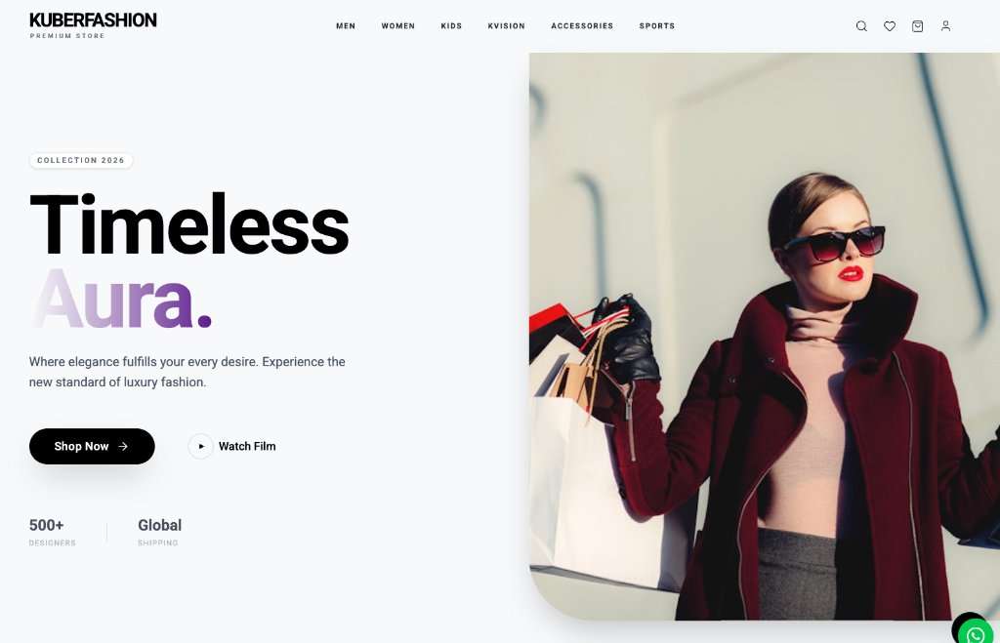
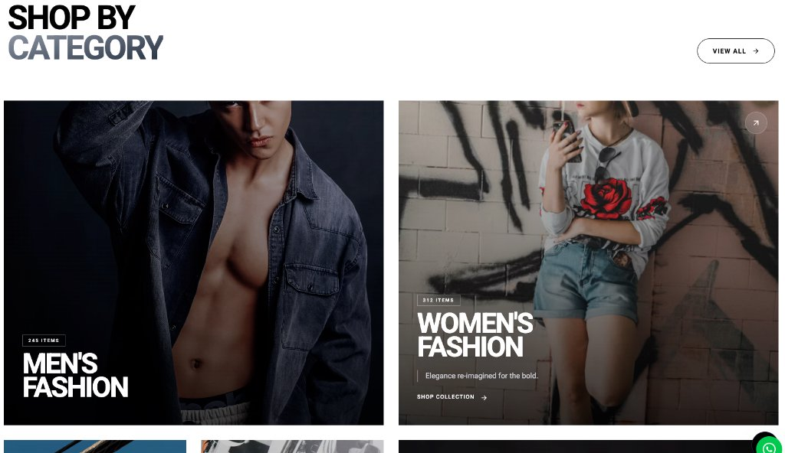
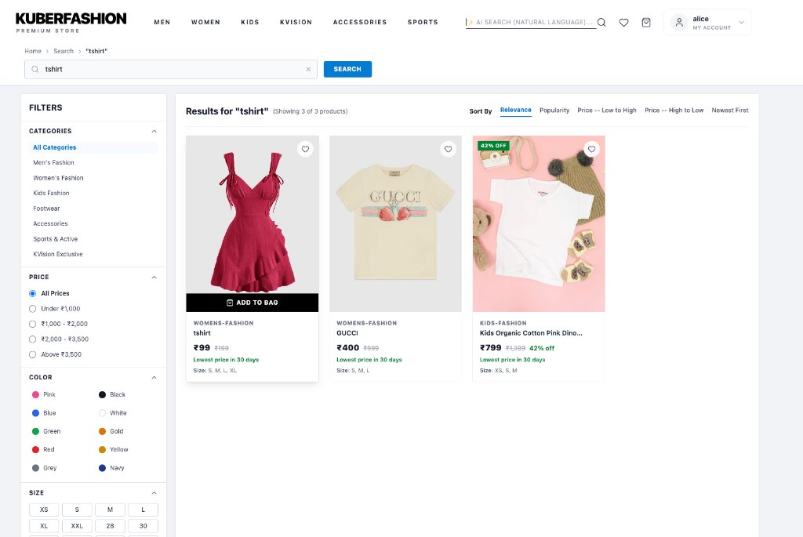
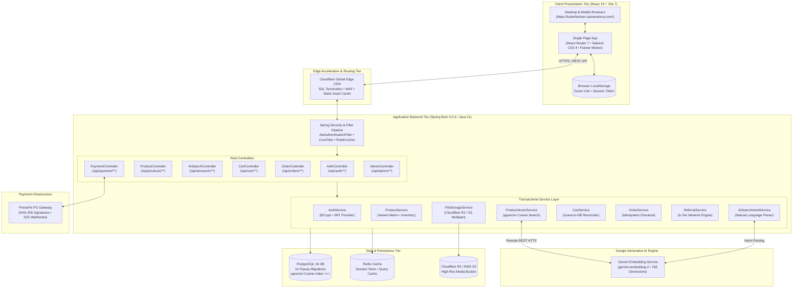

<div align="center">

# ✦ KUBERFASHION ✦
### *Next-Generation Haute Couture & Apparel E-Commerce Platform*

<p align="center">
  <a href="https://kuberfashion.saimandsroy.com/">
    
  </a>
</p>

[](https://kuberfashion.saimandsroy.com/)
[](https://kuberfashion.saimands.com/)
[](https://spring.io/projects/spring-boot)
[](https://openjdk.org/projects/jdk/21/)
[](https://react.dev/)
[](https://vitejs.dev/)
[](https://github.com/pgvector/pgvector)
[](https://ai.google.dev/)
[](https://www.phonepe.com/)

---

### [🌟 Explore Live Storefront](https://kuberfashion.saimandsroy.com/) &nbsp;•&nbsp; [📖 Architectural Guide](#-system-architecture) &nbsp;•&nbsp; [⚡ Localhost Quickstart](#-localhost-quickstart-guide) &nbsp;•&nbsp; [🧠 AI Engine](#-ai-semantic-search--recommendations) &nbsp;•&nbsp; [📡 API Endpoints](#-api-endpoints-reference)

---

</div>

<br />

## 📸 Visual Showcase & Interface Gallery

Experience the bespoke visual design of KuberFashion across customer journeys, AI discovery, dynamic filtering, and curated catalogs.

<div align="center">

### 💎 Editorial Hero Experience — Collection 2026
*Immersive responsive hero carousel featuring editorial photography, dynamic headline typography, animated CTAs, and global trust metrics.*

<p align="center">
  
</p>

<br />

### 🛍️ Curated Department & Category Matrix
*High-fashion category navigation cards with real-time inventory counts and directional hover animations.*

<table align="center" width="100%">
  <tr>
    <td width="50%" align="center">
      <b>Men's & Women's Fashion</b><br/><br/>
      
    </td>
    <td width="50%" align="center">
      <b>Special Offers, Accessories, Kids & Sports</b><br/><br/>
      
    </td>
  </tr>
</table>

<br />

### 🧠 AI-Powered Natural Language Search & Multi-Faceted Filters
*Semantic query comprehension powered by Google Gemini embeddings and pgvector cosine distance, accompanied by faceted price sliders, color pills, and size matrix selector.*

<p align="center">
  
</p>

<br />

### 🎯 Dynamic Recommendation Reels & Real-Time Trending Feed
*Personalized product feeds matching shopper taste profiles, price tiers, and algorithmic velocity tracking.*

<p align="center">
  
</p>

</div>

---

## 🏛️ System Architecture

KuberFashion operates as a **decoupled, event-tolerant full-stack cloud architecture**. The front end runs as a high-performance React 19 Single Page Application (SPA), orchestrated with a resilient Spring Boot 3.5.5 microservice backend on Java 21, backed by PostgreSQL 16 with `pgvector`, Redis distributed cache, Cloudflare R2 object storage, and Google Gemini AI services.

### High-Level Topology Flow



---

## ⚡ Core Application Features & Innovations

### 🧠 1. AI-Powered Natural Language Search & Semantic Intent
- **Semantic Vector Similarity:** Products are converted into dense 768-dimensional mathematical vector embeddings via Google's `gemini-embedding-2` model and indexed natively in PostgreSQL via `pgvector` HNSW cosine distance operators (`<=>`).
- **Natural Language Query Disambiguation:** Free-text queries like *"something warm and red under 2000 for women"* automatically extract:
  - Target Category (`womens-fashion`)
  - Target Color (`red`)
  - Target Price Filter (`max: 2000 INR`)
  - Search intent keywords with fallback heuristic recovery when offline.
- **Faceted Real-Time Filtering:** Dynamic server-side multi-attribute filtering across price bands, apparel colors, sizing matrices (`XS` to `XXL`), brand, and real-time stock availability.

### 👗 2. Complete Apparel Product Variant Matrix
- **Size & Color Selectors:** First-class SKU variant models supporting dynamic inventory counts per individual color and size combination.
- **Dynamic Pricing & Stock Protection:** Variant-level stock decrementing upon order reservation prevents overselling during flash events.
- **Interactive Variant UI:** Real-time stock alerts ("Only 2 left in Size M") and automatic price adjustments across variants.

### 🌳 3. KVision Multi-Tier Referral & Rewards Network
- **6-Level Genealogy Tree:** Multi-level referral tree allowing members to build downline teams up to 6 tiers deep.
- **Kuber Coupons & Wallet Balance:** Automatic coupon distribution upon referral milestone completion.
- **Administrative Network Visualizer:** Admin inspection tools displaying sitewide referral graphs, node volumes, downline commissions, and coupon adjustments.

### 💳 4. Enterprise Checkout & PhonePe Payment Processing
- **Strict Payment Idempotency:** Double-charge prevention with database unique transaction keys (`payment_transactions` & `orders` idempotency checks).
- **Server-to-Server Webhook Verification:** Validates PhonePe webhook signatures (`X-VERIFY` SHA-256 digests) and updates order states asynchronously (`PENDING` ➔ `CONFIRMED` ➔ `PROCESSING` ➔ `SHIPPED` ➔ `DELIVERED`).
- **Flexible Ordering Modes:** PhonePe Unified Payments Interface (UPI), Credit/Debit cards, Net Banking, and Cash on Delivery (COD) fallback.

### 🛒 5. Synchronized Multi-State Cart & Wishlist
- **Anonymous-to-Authenticated Cart Reconciliation:** Items added by unauthenticated guests into browser `localStorage` are automatically synchronized and merged with the customer's remote PostgreSQL cart upon sign-in.
- **Multi-Address Book:** Save multiple residential and office delivery destinations with default address flags.
- **Wishlist Toggle:** Instant one-click wishlist toggling with live count synchronization across header badges.

### 🛡️ 6. Hardened Security & Resilient Architecture
- **JWT Authentication Lifecycle:** Signed JSON Web Tokens with client-side memory handling and localStorage persistence.
- **Defensive Module Initialization:** Built-in client guards ensuring that third-party services (such as optional Supabase tools) never trigger unhandled startup errors or white-screen crashes when staging environment keys are omitted.
- **Granular Role-Based Access Control (RBAC):** Strictly enforces access boundaries between `ROLE_USER` and `ROLE_ADMIN` routes and controllers.

---

## 🛠️ Technology Stack Inventory

| Domain | Technology / Library | Version | Role & Architectural Purpose |
| :--- | :--- | :--- | :--- |
| **Frontend Framework** | **React** | `19.1.1` | Component-driven UI rendering with React 19 concurrent features |
| **Build Tooling** | **Vite** | `7.1.5` | Lightning-fast ESM dev server and optimized Rollup asset bundling |
| **Styling & Theme** | **Tailwind CSS** | `4.1.13` | Modern utility-first responsive stylesheet design |
| **Routing** | **React Router** | `7.x` | Declarative SPA route definitions with nested layouts and auth guards |
| **Animations** | **Framer Motion** | `11.x` | Smooth page transitions, drawer animations, and hover gestures |
| **Icons** | **Lucide React** | Latest | High-fidelity vector iconography across the storefront |
| **HTTP Client** | **Axios** | `1.7.x` | Intercepted client requests with automated JWT bearer attachment |
| **Backend Core** | **Spring Boot** | `3.5.5` | Enterprise microservice architecture and dependency injection |
| **Language Runtime** | **Java OpenJDK** | `21 LTS` | Modern virtual threads, pattern matching, and record constructs |
| **Security** | **Spring Security** | `6.x` | Stateless filter pipeline, password hashing (BCrypt), and JWT validation |
| **Primary Database** | **PostgreSQL** | `16.x` | ACID relational database engine with JSONB and element collections |
| **Vector Engine** | **pgvector** | `0.7+` | Native high-dimensional vector embeddings with cosine indexing |
| **Database Migrations** | **Flyway** | `10.x` | 14 automated schema versions with safe forward migrations |
| **ORM & Persistence** | **Hibernate / JPA** | `6.x` | Object-relational mapping, custom specifications, and caching |
| **Caching Engine** | **Redis** | `7.x` | In-memory distributed caching for catalog and session workloads |
| **AI Embeddings** | **Google Gemini AI** | `gemini-embedding-2` | 768-dimensional text embeddings and natural language intent classification |
| **Payment Gateway** | **PhonePe PG SDK** | `v1` | Production payment gateway orchestration and webhook reconciliation |
| **Cloud Storage** | **Cloudflare R2 / S3** | REST API | Multi-region S3-compatible media bucket for product photography |
| **Edge CDN** | **Cloudflare** | DNS & Pages | Edge caching, DDoS mitigation, and global SSL delivery |

---

## 🗄️ Database Schema & Flyway Migrations (V1 — V14)

The database schema is managed via forward-only, idempotent **Flyway SQL migrations**:

```
kuberFashion_backend_2025-main/src/main/resources/db/migration/
├── V1__Create_users_table.sql                # Base users, roles, referral relationships
├── V2__Add_Product_Indexes.sql               # Performance indexes for categories & prices
├── V3__Fix_Schema_Issues.sql                 # Data type corrections & foreign key alignments
├── V4__Add_Addresses_Table.sql               # Multi-address customer shipping address book
├── V5__Add_Payment_Transactions_Table.sql    # Idempotent PhonePe transaction ledger
├── V6__Add_Order_Shipping_Fields.sql         # Order tracking, courier numbers & notes
├── V7__Update_Payment_Method_Constraint.sql  # Payment enum validations (UPI, CARD, COD)
├── V8__Fix_Order_Items_Columns.sql           # Snapshot unit prices and variant attributes
├── V9__Add_Order_Idempotency_Constraint.sql  # Strict duplicate order submission locks
├── V10__Add_Product_Variant_Inventory.sql    # Variant tables (sizes, colors, SKUs, inventory)
├── V11__Add_Product_Embedding_Vector.sql     # pgvector 768-dim column & vector index (<=>)
├── V12__Add_Embedding_Model_Tracking.sql     # Embedding version tracking and model metadata
├── V13__Reconcile_Product_Active_Schema.sql  # Category synchronization & active product flags
└── V14__Create_Reward_And_Referral_Tables.sql# KVision network genealogy, rewards & balances
```

---

## 💻 Localhost Quickstart Guide

Run the full KuberFashion stack locally on your machine for development and testing.

### 📋 Prerequisites
- **Java Development Kit (JDK):** Version 21 LTS (`java -version`)
- **Apache Maven:** Version 3.9+ (`mvn -version`)
- **Node.js:** Version 20 LTS or higher (`node -v`)
- **Docker & Docker Compose:** For running PostgreSQL (with pgvector) and Redis locally

---

### ⚡ Method 1: Automated Launch with Docker Compose (Recommended)

1. **Clone the repository:**
   ```bash
   git clone https://github.com/saimandsxroy/kuberFashion_frontend_2025.git frontend
   git clone https://github.com/saimandsxroy/kuberFashion_backend_2025.git backend
   ```

2. **Start PostgreSQL (with pgvector) & Redis:**
   ```bash
   cd backend
   docker-compose up -d
   ```
   *This starts:*
   - PostgreSQL 16 on `localhost:5432` with the `vector` extension pre-loaded.
   - Redis cache on `localhost:6379`.

---

### 🚀 Method 2: Manual Localhost Execution

#### Step 1: Start the Backend (Spring Boot)

1. Navigate to the backend directory:
   ```bash
   cd kuberFashion_backend_2025-main
   ```

2. Ensure your local environment variables or `application-dev.properties` are configured:
   ```properties
   # Database connection
   spring.datasource.url=jdbc:postgresql://localhost:5432/kuberfashion_dev
   spring.datasource.username=postgres
   spring.datasource.password=postgres

   # JWT secret
   jwt.secret=YourSuperSecretKeyWithMinimumLengthOf256BitsForHMACSHA256Algorithm
   jwt.expiration=86400000

   # AI Search (Optional: Set your Gemini key for vector search)
   ai.gemini.api-key=YOUR_GEMINI_API_KEY
   ai.search.vector-enabled=true
   ```

3. Build and launch the Spring Boot service:
   ```bash
   ./mvnw clean spring-boot:run
   ```
   *The backend will boot up at `http://localhost:8080` and automatically execute Flyway migrations V1 through V14.*

4. Verify backend health:
   ```bash
   curl http://localhost:8080/actuator/health
   # Returns: {"status":"UP"}
   ```

---

#### Step 2: Start the Frontend (React + Vite)

1. Open a new terminal and navigate to the frontend directory:
   ```bash
   cd kuberFashion_frontend_2025-main
   ```

2. Install dependencies:
   ```bash
   npm install
   ```

3. Create your local `.env` file (copied from `.env.example`):
   ```bash
   cp .env.example .env
   ```
   *Confirm the API URL:*
   ```env
   VITE_API_BASE_URL=http://localhost:8080/api
   VITE_API_TIMEOUT=10000
   VITE_APP_NAME=KuberFashion
   VITE_DEFAULT_CURRENCY=₹
   ```

4. Start the Vite hot-module-reloading development server:
   ```bash
   npm run dev
   ```
   *The frontend application will be live at:* `http://localhost:5173`

5. Open your browser and navigate to:
   ```
   http://localhost:5173
   ```

---

### 🔑 Default Development Credentials

| Role | Email Address | Password | Permissions |
| :--- | :--- | :--- | :--- |
| **Administrator** | `admin@kuberfashion.com` | `admin123456` | Full access to `/admin` dashboard, catalog management, order fulfillment, media uploads & genealogy tree |
| **Test Customer** | `root@ref.com` | `Pass@123` | Browsing, shopping cart, checkout, address book, personal referral dashboard |

*(You can also populate 10 multi-tier referral test users by running `./create_users.sh` against a running backend).*

---

## 📡 API Endpoints Reference

The backend exposes a comprehensive suite of RESTful JSON endpoints secured via Spring Security and JWT Bearer tokens:

<details>
<summary><b>🔐 Authentication & Identity (<code>/api/auth/**</code>)</b></summary>
<br/>

| Method | Path | Access | Description |
| :--- | :--- | :--- | :--- |
| `POST` | `/api/auth/register` | Public | Register new customer account (with optional referral code) |
| `POST` | `/api/auth/login` | Public | Authenticate user with email and password; returns JWT token |
| `POST` | `/api/auth/phone-login` | Public | Authenticate via registered phone number and password |
| `GET` | `/api/auth/me` | Authenticated | Retrieve authenticated user profile and roles |
| `POST` | `/api/auth/logout` | Authenticated | Invalidate current session |

</details>

<details>
<summary><b>🛍️ Products & Catalog (<code>/api/products/**</code>)</b></summary>
<br/>

| Method | Path | Access | Description |
| :--- | :--- | :--- | :--- |
| `GET` | `/api/products` | Public | Paginated product list with category, price, and color filters |
| `GET` | `/api/products/{id}` | Public | Retrieve single product details including SKU variant list |
| `GET` | `/api/products/slug/{slug}` | Public | Retrieve product by SEO-friendly URL slug |
| `GET` | `/api/products/featured` | Public | Retrieve curated catalog items marked as featured |
| `GET` | `/api/products/trending` | Public | Retrieve highest velocity / newest trending fashion |
| `GET` | `/api/products/offers` | Public | Retrieve products with active percentage discounts |
| `GET` | `/api/products/category/{slug}` | Public | Retrieve products belonging to a designated category slug |
| `GET` | `/api/products/recommendations` | Public / Auth | Behavioral product recommendations ("Inspired by Your Interest") |

</details>

<details>
<summary><b>🧠 AI Search & Semantic Vectors (<code>/api/ai/search/**</code>)</b></summary>
<br/>

| Method | Path | Access | Description |
| :--- | :--- | :--- | :--- |
| `POST` | `/api/ai/search` | Public | Natural language intent extraction and semantic vector cosine search |
| `GET` | `/api/ai/search/suggestions` | Public | Real-time autocomplete suggestions based on query intent |
| `POST` | `/api/admin/embeddings/backfill` | `ROLE_ADMIN` | Batch generate vector embeddings for all products via Gemini AI |

</details>

<details>
<summary><b>🛒 Cart & Checkout (<code>/api/cart/**</code> & <code>/api/orders/**</code>)</b></summary>
<br/>

| Method | Path | Access | Description |
| :--- | :--- | :--- | :--- |
| `GET` | `/api/cart` | Authenticated | Fetch active user cart items and variant details |
| `POST` | `/api/cart/add` | Authenticated | Add item to cart with specific size/color variant |
| `PUT` | `/api/cart/items/{id}` | Authenticated | Update quantity of a designated cart item |
| `DELETE` | `/api/cart/items/{id}` | Authenticated | Remove specific item from cart |
| `DELETE` | `/api/cart/clear` | Authenticated | Clear user's active cart |
| `POST` | `/api/orders` | Authenticated | Place idempotent order with delivery address and payment choice |
| `GET` | `/api/orders` | Authenticated | Retrieve customer's historical orders |
| `GET` | `/api/orders/{id}` | Authenticated | Retrieve granular order status, tracking, and item snapshots |

</details>

<details>
<summary><b>💳 Payments & PhonePe Integration (<code>/api/payment/**</code>)</b></summary>
<br/>

| Method | Path | Access | Description |
| :--- | :--- | :--- | :--- |
| `POST` | `/api/payment/phonepe/initiate` | Authenticated | Generate PhonePe payment URL and transaction payload |
| `POST` | `/api/payment/phonepe/callback` | Public | S2S Webhook handler verifying PhonePe checksum & updating order state |
| `GET` | `/api/payment/phonepe/status/{txId}` | Authenticated | Poll real-time transaction reconciliation status |

</details>

<details>
<summary><b>🛡️ Administrative Control (<code>/api/admin/**</code>)</b></summary>
<br/>

| Method | Path | Access | Description |
| :--- | :--- | :--- | :--- |
| `GET` | `/api/admin/dashboard/stats` | `ROLE_ADMIN` | Executive revenue, active orders, and member metrics |
| `POST` | `/api/admin/products` | `ROLE_ADMIN` | Create new catalog product with variants and photo uploads |
| `PUT` | `/api/admin/products/{id}` | `ROLE_ADMIN` | Edit catalog pricing, discount rates, inventory, and visibility |
| `DELETE` | `/api/admin/products/{id}` | `ROLE_ADMIN` | Soft-delete or archive product from storefront |
| `GET` | `/api/admin/orders` | `ROLE_ADMIN` | Sitewide order lifecycle management and shipping status updates |
| `POST` | `/api/admin/uploads` | `ROLE_ADMIN` | Direct multipart media upload to Cloudflare R2 / AWS S3 |
| `GET` | `/api/admin/referrals/tree` | `ROLE_ADMIN` | Global 6-level referral genealogy visualization |

</details>

---

## 📁 Repository & Monorepo Structure

```
KF/
├── docs/
│   └── images/                               # Showcase screenshots & editorial previews
│       ├── 01-hero-collection-2026.jpg
│       ├── 02-shop-by-category-men-women.jpg
│       ├── 03-category-showcase-kids-accessories.jpg
│       ├── 04-ai-search-filters.jpg
│       └── 05-personalized-recommendations-trending.jpg
│
├── kuberFashion_frontend_2025-main/          # React 19 + Vite 7 Single Page Application
│   ├── src/
│   │   ├── admin/                            # Administrative layout, analytics, inventory
│   │   ├── components/                       # Hero, ProductRibbon, Navbar, Footer, Filter
│   │   ├── context/                          # CartContext, WishlistContext state providers
│   │   ├── data/                             # Fallback products & resilient catalog helpers
│   │   ├── hooks/                            # useAuth authentication lifecycle hooks
│   │   ├── lib/                              # Safe client initialization wrappers
│   │   ├── pages/                            # HomePage, SearchResults, LoginPage, CartPage
│   │   ├── services/                         # Axios client & typed REST service adapters
│   │   ├── user/                             # Customer checkout, orders, address, profile
│   │   └── utils/                            # Auth token helpers, formatters, validation
│   ├── package.json
│   ├── vite.config.js
│   └── tailwind.config.js
│
├── kuberFashion_backend_2025-main/           # Spring Boot 3.5.5 / Java 21 Microservice
│   ├── src/main/java/com/kuberfashion/backend/
│   │   ├── config/                           # SecurityConfig, CorsConfig, RedisConfig
│   │   ├── controller/                       # RestControllers for public, user, and admin
│   │   ├── dto/                              # Request/Response Data Transfer Objects
│   │   ├── entity/                           # JPA Hibernate Entities (Product, Order, User)
│   │   ├── repository/                       # Spring Data JPA Repositories
│   │   └── service/
│   │       ├── ai/                           # GeminiEmbeddingService, AiSearchIntentService
│   │       ├── ProductVectorService.java     # pgvector cosine similarity search engine
│   │       ├── RecommendationService.java    # Taste-profile collaborative recommendation
│   │       ├── OrderService.java             # Order fulfillment & idempotency
│   │       └── FileStorageService.java       # Cloudflare R2 / AWS S3 multipart uploader
│   ├── src/main/resources/
│   │   ├── db/migration/                     # 14 Flyway forward SQL schema migrations
│   │   ├── application.properties
│   │   ├── application-dev.properties
│   │   └── application-prod.properties
│   ├── docker-compose.yml                    # Local PostgreSQL (pgvector) & Redis containers
│   └── pom.xml                               # Maven project dependencies and build plugins
│
├── create_users.sh                           # Multi-tier referral test seed generator script
└── README.md                                 # Master monorepo architecture and showcase documentation
```

---

## 🌐 Production Deployments & Domains

- **Primary Production Domain:** [https://kuberfashion.saimandsroy.com/](https://kuberfashion.saimandsroy.com/)
- **Mirror / Secondary Domain:** [https://kuberfashion.saimands.com/](https://kuberfashion.saimands.com/)
- **SSL / Edge Acceleration:** Cloudflare Managed Edge with HTTP/2 & HTTP/3 multiplexing.
- **Frontend Hosting:** Cloudflare Pages with automated git-driven continuous delivery.

---

## 📜 Intellectual Property & Governance

Copyright © 2026 **Kvision Business Solution Private Limited**. All Rights Reserved.  
*KuberFashion™ and KVision Network™ are proprietary registered marks of Kvision Business Solution Private Limited.*

---

<div align="center">
  <sub>Engineered with precision using React 19, Spring Boot 3.5, PostgreSQL pgvector, and Google Gemini AI.</sub><br/>
  <b><a href="#-kuberfashion-">▲ Back to Top</a></b>
</div>
